<p align="center">
  
</p>

<p align="center">
  <samp>PYTHON · OPENCV · PYQT6 · C# · WINFORMS · BLENDER</samp>
</p>


### <samp>01 — WHAT IT IS</samp>

"Where's Zizgő?" Given a busy photo, find one particular figure in it. A semester project
for an image-processing course at Óbuda University.

The reference images are not photographs. A Blender scene renders the figure across camera
angles and lighting conditions, which gives a template set that covers how it can actually
appear. Each template is then matched against the search photo, restricted by a colour
mask, and the best hit wins.

It is built twice: once in Python on top of OpenCV, and once in C# written directly
against raw pixels.

### <samp>02 — HOW IT WORKS</samp>

```
Blender scene ──► rendered templates (sitting, lying; many angles and lights)
                         │
search photo ──► colour mask ──► template matching, one template at a time
                                        │
                                        ▼
                          best score ──► bounding box on the photo
```

### <samp>03 — TWO IMPLEMENTATIONS</samp>

| | Python | C# |
|---|---|---|
| Entry point | `Kereso.py` | `ZizgoKereso/` (WinForms, .NET 8) |
| Matching | HSV colour mask (`inRange`), then OpenCV `matchTemplate` with normalised correlation and a template mask | Mean absolute colour difference in `TemplateMatcher`, sampled on an 8-pixel grid, ignoring transparent and near-black template pixels |
| Pixel access | NumPy arrays | `FastBitmap`, unsafe pointers over locked bitmap data |
| UI | PyQt6, with a live window showing the current template, the mask and the match heatmap | WinForms, draws the bounding box on the result |

### <samp>04 — RUN IT</samp>

Python:

```bash
pip install opencv-python numpy PyQt6
python Kereso.py
```

C# (Windows, .NET 8 SDK):

```bash
dotnet run --project ZizgoKereso
```

In either one, load a search photo and point it at a template folder.

### <samp>05 — LAYOUT</samp>

| Path | What it is |
|---|---|
| `untitled.blend` | The Blender scene that renders the templates |
| `GeneratedPictures_*/`, `Ulo_Zizgo_*/`, `Zizgo_Ulo_*/`, `Zizgo_Fekvo_*/` | Rendered template sets (*ülő* = sitting, *fekvő* = lying) |
| `metadata.csv` | Render metadata for the template sets |
| `Keres/` | Search photos |
| `ZizgoRef/` | The reference sets and search photos, grouped in one place |
| `Zizgo_Eredmeny_*/` | Saved results, one folder per run |
| `DP3HYC_Kepfeldolgozas_feleves.docx`, `HolVanZizgo.docx` | Project reports (Hungarian) |


<p align="center">
  <a href="https://github.com/Deatron01"></a><br />
  <sub><i>Little chaos in a quiet mind.</i></sub><br />
  <sub><samp>MORE WORK AT <a href="https://github.com/Deatron01">GITHUB.COM/DEATRON01</a></samp></sub>
</p>
